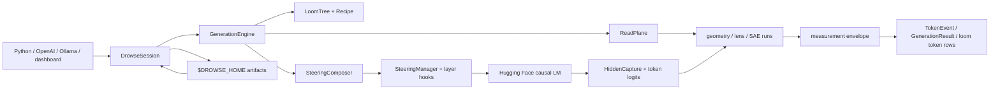

# Drowse architecture

How the system fits together: how artifacts are fitted, how a steering
expression reaches a model forward, how hidden states become measurements, and
how the library, server, dashboard and browser edition share those paths.

This file stays at the cross-cutting level: the data flow, the reasons behind
the strict boundaries, and the invariants a change in one package can break in
another. Contracts, constants and module maps live in each package's
`AGENTS.md`; this file points to them instead of restating them. The layer
order and the repo-wide rules are in the root `AGENTS.md`.

## 1. System in one page

One `DrowseSession` owns one loaded model. Three front doors reach it:

- the Python API (`DrowseSession`);
- `drowse serve`, which exposes OpenAI `/v1/*`, Ollama `/api/*` and the native
  `/drowse/v1/*` protocol on one port;
- the Svelte dashboard mounted by that server, which drowse.ai also runs in
  the browser against a WebGPU runtime.

All of them converge on the same generation, steering, capture and measurement
paths.



The engine has two deliberately separate planes:

- The **steering plane** resolves an expression, composes every compatible
  term into one update per affected layer, and injects it.
- The **read plane** plans hidden-state retention, binds frozen per-generation
  instrument state, and produces geometry, J-lens and SAE readings without
  touching the steering representation.

They meet at **gates**: a steering trigger may depend on a read-side scalar, so
the capture plan must retain and score exactly the channels needed before the
next steered forward.

## 2. Ownership

| Concern | Owner |
|---|---|
| Model loading, fingerprints, layer discovery, chat/role/scene rendering | `model/` (`load.py`, `fingerprint.py`, `arch.py`, `scene.py`) |
| Session facade, exclusive-GPU lock, artifact registry, neutral baseline | `session/session.py`, `registry.py`, `neutral.py` |
| The generation transaction and decode routing | `session/engine.py` (`GenerationEngine`), `session/batch.py` |
| Decode loop, sampler, rendering, prefix cache, compile routing | `generation/` |
| Expression grammar and IR | `steering/grammar.py`, `terms.py`, `triggers.py` |
| Resolution, composition, gains, hooks | `steering/composer.py`, `steering/hooks.py` |
| Steering math (synthesis, the kernel, fold, projection) | `geometry/inject.py`, `geometry/fold.py` |
| Read contract, Monitor, capture planning, envelope | `readout/` |
| Applying the read plan to one generation | `generation/read_plane.py::ReadPlane` |
| J-lens and SAE families | `lens/`, `sae/` |
| Extraction and fitting | `fit/` (`pipeline.py`, `corpus.py`, `capture.py`, `node_stats.py`, `publish.py`, `preflight.py`) |
| Artifact formats, selectors, distribution | `store/` |
| Conversation tree, recipes, replay, transcripts | `loom/` |
| Protocols, dashboard mount, CLI | `server/`, `web/`, `cli/` |

Dependencies point downward only (`tests/invariants/test_layering.py`). A
collaborator gets its dependencies through its constructor; nothing outside
`drowse/session/` reads a session private. That rule is what lets each
collaborator be tested without a session and lets the browser runtime replace
whole subsystems behind the same contracts.

## 3. Artifacts and runtime objects

### 3.1 The manifold is the steering artifact

A manifold is a set of labeled nodes, a domain or discovered layout, and a
per-model fit at selected residual-stream layers. A fitted layer is a
`LayerSubspace` (`geometry/subspace.py`) in one of two geometries:

- **Flat**: a neutral-anchored affine frame (`mean`, orthonormal `basis`, real
  per-layer node coordinates). A rank-1, 2-node flat fit is the ordinary
  bipolar steering vector; a 1-node flat fit is a monopolar ray from the
  neutral mean.
- **Curved**: the same enclosing frame plus an `r³` polyharmonic RBF surface
  through the node centroids, a neutral-origin foot, and optionally a learned
  tube thickness σ(z).

`Manifold` (`geometry/manifold.py`) groups the layers with the authoring
metadata. `SynthesizedSubspace` is not durable: it is the per-dispatch result
of composing an expression's affine terms.

`Profile` (`geometry/profile.py`) is the in-memory `{layer: direction}` view
that vector-shaped consumers need: comparison, projection operands, J-lens and
SAE atoms, GGUF export. Extracted concepts are not stored twice. A fitted
2-node manifold is folded to a `Profile` on demand
(`geometry/fold.py::folded_directions`), and the folder stays the only stored
artifact.

### 3.2 Fit modes

`manifold.json::fit_mode` is one of five:

| Mode | Coordinates | Result |
|---|---|---|
| `authored` | supplied with a domain | curved, exact at nodes |
| `pca` | discovered from the corpora | flat |
| `spectral` | discovered from neighborhood geometry | curved, GCV-smoothed |
| `auto` | `select_topology` picks per model | flat, curved, or periodic |
| `baked` | none (a precomputed direction from `bake`) | flat, not refittable |

Extraction is discover-`pca` capped at rank 1. There is no separate vector
method and no `pca` selector variant. Because `auto` resolves per model, the
same folder can be flat on one model and curved on another; the resolved
geometry and the ranked candidates are recorded in the fitted sidecar.

### 3.3 Templates

Some categories are referenced rather than embodied: days of the week, months,
directions. "Someone who is Tuesday" is nonsense, so persona-framed elicitation
does not apply. A template (`store/templates.py`) is a slot token, candidate
values, and one or more multi-turn contexts whose final assistant turn carries
the slot exactly once (never in the shared history). It has two consumers:

- `ChoiceScorer` (`generation/scoring.py`, via `session.score_choices` /
  `score_template`) reads the restricted-choice distribution over the values
  from the raw model distribution, optionally under steering. This answers the
  project's core question directly: did steering shift the distribution, not
  just the argmax?
- `manifold from-template` materializes one node corpus per value and keeps a
  `template_ref`, whose content hash folds into the fit identity so a context
  or value edit refits.

### 3.4 Per-model read sources

The Jacobian lens and SAEs are model-scoped sources, not concept manifolds.
Both use `base/source_registry.py::SourceFamily`: an `active.json` selection,
Drowse-owned `local/<name>/` artifacts, and commit-pinned provider bindings
whose payloads stay in the Hugging Face cache.

- A lens is one fp32 `J_l = E[∂h_final/∂h_l]` per fitted source layer, keyed
  by `LensKey` (kind J standard or R RelP; stored as format v7, `local:j` and
  `local:r`). Providers: `neuronpedia`, `workspace-r`, `workspace-j`.
- An SAE is a local ReLU dictionary trained here or a SAELens release (the
  `[sae]` extra), held resident at one hook layer per session.

A source switch becomes visible at the next generation's bind, never halfway
through a bound run. Details: `drowse/lens/AGENTS.md`, `drowse/sae/AGENTS.md`.

### 3.5 Loom and results

`LoomTree` (`loom/tree.py`) is the session's authoritative conversation graph.
A node records role and cast label, recipe, raw token ids, token rows with
their measurement envelopes, aggregate readings, committed thinking, notes and
stars. **Provenance is recipe presence**: a node with a `Recipe` was generated
(in either seat, since the model can speak the user seat), and `recipe=None`
means authored. Rendering, transcripts, authored capture and joint logprobs all
key on this; never infer provenance from `role`.

Generation returns a list-like `RunSet` of `GenerationResult`; streaming yields
`TokenEvent`s and exposes the result at close. The loom and the results share
data but are not aliases: `stateless=True` calls, and every OpenAI and Ollama
request, produce results without touching the tree.

## 4. State and artifact identity

All state resolves through `base.paths.drowse_home()` (`$DROWSE_HOME`, default
`~/.drowse`). The tree is documented in `drowse/store/AGENTS.md`; lens and SAE
subtrees in their packages. Conversations are never autosaved.

Every model-bound artifact keys on one of two identities from
`model/fingerprint.py`:

- `model_source_fingerprint`: metadata only, computable before load. The
  weight-free preflights (`fit/preflight.py`, `lens/lifecycle.py`) use it to
  prove a repeat is a no-op without loading weights.
- `loaded_model_fingerprint`: the live weights. Fitted tensors bind it.

A fitted manifold sidecar carries the loaded fingerprint, a `nodes_sha256`
over everything authored (labels, corpora, roles, kinds, coords or
hyperparameters, the resolved template), a `capture_sha256` over the exact
rendered token ids and pool positions, the selected layers and
`MANIFOLD_FIT_POLICY_VERSION`. A cached fit is reused only when all of them
match; the registry recomputes `capture_sha256` on load, so rendering must stay
deterministic. Provider bindings pin commits. Declared files and fitted
payloads are sha256-verified before adoption.

Writers use stable artifact locks outside removable folders, temporary files,
fsync, and atomic pointer or manifest swaps. A fit publishes by
compare-and-swap against an authoring snapshot (`fit/publish.py`), so a paused
fit can never overwrite a folder that was cleared or replaced meanwhile. Long
fits (the J-lens) publish immutable shard generations and leave the previous
complete generation authoritative until the new pointer is durable. Readers
never treat an incomplete or mismatched artifact as a partial success.

## 5. Extraction and fitting

There is one pipeline, `fit/pipeline.py::ManifoldExtractionPipeline`. A
steering vector is the 2-node flat case, so `session.extract` and `manifold
fit` run the same stages: inputs (snapshot, identity, cache check), capture,
geometry (pure tensors), publish. Details: `drowse/fit/AGENTS.md`.

### 5.1 Conversational corpora

`fit/corpus.py::CorpusGenerator` has the model answer a shared set of baseline
prompts (`drowse/data/baseline_prompts.json`, 48 prompts) in character. The
concept rides a system prompt chosen by `kind` (abstract "someone {c}",
concrete "{art} {c}", or a custom template) and a swapped assistant-role label.
The corpus is a response list aligned `response[i] ↔ prompt[i % k]`.

Capture pools the swapped-back `[user: prompt, assistant: response]` pairs in
standard-assistant space: the persona is generation-only and its signal rides
the text. Only an explicit role (`--role`, the `:role-<name>` variant) is also
substituted at capture, and the same substitution is applied at steering time,
so the extract baseline equals the steer baseline.

The neutral corpus (`drowse/data/neutral_statements.json`) answers the same
prompts with no persona. One length directive leads the system prompt at all
four sites (node and neutral generation, node and neutral capture). As
common-mode it cancels in `node − neutral`, it matches capture framing to
generation framing, and it keeps answers short. The shared prompts hold topic
common-mode across nodes, so centroids stay comparable without a per-manifold
scenario set.

### 5.2 Capture and the baseline-match contract

Rows are rendered and tokenized once and pooled at
`model/tokens.py::last_content_index`: the last non-special token before the
chat-template trailer. The monitor, the read plane, the naturalness eval and
the drowse.ai capture pool at the same position. Capture batches across node
boundaries in right-padded batches that halve on OOM, aborts after the last
requested block (the final norm and LM head never run), and reduces to
centroids on device unless a curved fit needs rows, which spool to a
layer-major store. A content-addressed capture cache
(`models/<safe>/manifold_capture/`) lets geometry-only refits skip the
forwards.

Fit capture renders through `apply_chat_template` (or
`model/role_templates.py::apply_with_role`), while generation renders through
the scene stitcher (`model/scene.py`). The stitcher's byte-exact round-trip
validation against the template is what keeps the two renders identical; a
family that fails it falls back to the template path.

### 5.3 Neutral anchoring and the Mahalanobis metric

Neutral activations are cached fp32 per model (`store/neutral.py`). This is a
range invariant: late-layer residual channels overflow fp16 and would poison
every covariance-derived read.

`geometry/whitener.py::LayerWhitener` keeps the centered neutral rows and a
Woodbury form of the regularized inverse covariance. It applies `Σ⁻¹`, computes
Mahalanobis norms and cosines, forms reduced-space Grams and the LEACE
projection, all without a dense hidden-size-squared matrix.

Every activation-space surface requires complete finite whitener coverage of
its layers (the root `AGENTS.md` "Mahalanobis only" rule), because a few
massive-activation ("rogue") channels dominate the Euclidean metric on real
LMs.

Every fitted frame is neutral-anchored: the stored mean is the projection of
the neutral mean into the span, node coordinates are measured from it, and
coordinate 0 means neutral. The basis comes from the node-centroid scatter
around the nodes' own mean, never around neutral: anchor-centering would inject
the neutral offset as a spurious axis and break PCA@2 ≡ difference-of-means.
With a whitener the basis maximizes `vᵀS_b v / vᵀΣv` (the Fisher/LDA
objective), which divides each direction by its background variance so the
rogue channels cancel the way they cancel in a difference of means.

### 5.4 Discovering and fitting geometry

For discover modes each layer contributes its whitened, node-mean-centered Gram
matrix, and coordinates come from their mean, the consensus Gram. Whitening
puts every layer in common units, so the average is signal-weighted and needs
no reference layer: a layer where the nodes do not separate drops out on its
own. PCA coordinates are its leading eigenvectors (up to `var_threshold`,
capped at `max_dim`); spectral coordinates come from Laplacian eigenmaps on a
k-NN graph; `auto` chooses flat versus curved by GCV and detects periodic axes
by Vietoris–Rips H1 persistence (`geometry/topology.py`).

Flat fits store the frame and real per-layer node coordinates; their display
layout is translated onto neutral so `% 0,…,0` reads as neutral. Curved fits
add the RBF surface, smoothed by a GCV-selected λ against centroid noise
(authored fits stay exact so a node is an exact steering target), and raw
curved fits learn the σ tube from the retained rows.

Each fit bakes a per-layer Mahalanobis `share`, the cross-layer budget the
hooks normalize at apply time. Discriminative layer selection (Selective
Steering, Dang & Ngo 2026) keeps a flat axis at a layer only when the node
projections relative to neutral straddle zero: same-side layers encode
intensity, not polarity. `--no-dls` opts out. Curved fits have no polarity and
skip DLS.

A monopolar concept (`extract(concept)` with no baseline) is a genuine 1-node
fold of `concept − ν` into a neutral-anchored ray: neutral is the implicit
negative pole, and the difference already cancels common-mode like DiM does.

## 6. Steering language and lowering

### 6.1 One grammar

Python, YAML `vectors:`, HTTP, CLI and loom recipes all parse through
`steering/grammar.py::parse_expr`, and `format_expr` round-trips the result.
Results, recipes and scoring stamp `str(steering)`, so every stored steering is
replayable. The authoritative grammar, resolution ladder and trigger table are
in `drowse/steering/AGENTS.md`. In brief:

| Form | Meaning |
|---|---|
| `0.3 warm` | push toward a pole or label |
| `a~b`, `a\|b` | keep / remove the Mahalanobis component of `a` shared with `b` |
| `!a` | mean-ablate `a` (`h' = h − α(h·d̂ − μ·d̂)d̂`) |
| `along[,onto] M%label`, `M%x,y` | move toward a node or coordinates of a manifold |
| `@response`, `@after`, `@first:N`, … | restrict the token phase or window |
| `@when:probe>t` | fire only while a read-side scalar holds |
| `jlens/<word>`, `sae/<id>` | instrument atoms in reserved namespaces |

### 6.2 Resolution and composition

`SteeringComposer` turns a parsed `Steering` into a `SteeringPlan`.
`open_scope` resolves and loads every artifact before the scope is entered, so
an unknown name fails before any state changes. A bare slug resolves through
the ladder in `store/selectors.py::resolve_bare_atom` (node label, then 2-node
name, then plain key); collisions raise `AmbiguousSelectorError` instead of
choosing silently. The scope's assistant-role label is resolved from the terms
(explicit `:role-<id>` keys must agree; implied roles from `%` terms resolve to
the strongest with a warning).

Composition groups terms by trigger. Vectors are folded into neutral-anchored
rank-1 frames, `~`/`|` results are folded the same way, ablations contribute
collapse axes, and affine `%` terms contribute their fitted basis and target.
All affine terms of one trigger become one `SynthesizedSubspace` per layer
(`geometry/inject.py::synthesize_subspace`), so terms sharing a layer
superpose instead of colliding; partial, repeated, negative and non-orthogonal
ablations get exact per-axis coefficients. Each curved `%` term stays its own
term. Two curved spans may share a layer only when they are orthogonal
(`OverlappingManifoldError` otherwise), and the merged affine span is
orthogonalized against them, the curved term owning the overlap.

One resolution subtlety is easy to miss: once the registry holds a profile
under a 2-node name (after `session.extract`, or after the name was used as a
`!`/`~`/`|` operand), a bare `formal.casual` parses as a folded-vector push
instead of a `%` push toward its positive node. The two weight layers
differently (folded share versus the pole's neutral-anchored coordinate).

### 6.3 The kernel

`geometry/inject.py::subspace_inject` is the semantic definition of every
injection. It splits `h = mean + H_m + H_n + H_o` (surface foot, off-surface
in-subspace residual, off-subspace residual) and applies two operations:

- **along** translates the foot by a fixed `along·(target − origin)` offset.
  A fixed offset preserves each token's in-subspace spread; lerping each foot
  onto the absolute target erases it and loop-collapses at strong push. On a
  curved surface the off-surface residual is transported to the new tangent
  frame by a norm-preserving rotation that is exactly the identity when the
  foot does not move.
- **onto** shrinks the off-surface residual toward the surface: by `(1 − onto)`
  with no σ-field, or toward the local tube thickness σ(z) with one, so
  `onto = 1` lands on the surface's typical set rather than its zero-thickness
  wire. It is vacuous for flat terms.

`H_o`, the off-subspace residual, is always kept verbatim. It contains every
composing neighbor's span, which is why a vector and several orthogonal
manifolds compose with zero cross-talk.

On a flat subspace the foot is the projected coordinate and the kernel reduces
to an analytic slide, with no foot solve, RBF or norm cap (a flat fit cannot
extrapolate off-domain). At runtime affine terms run
`steering/hooks.py::AffineOp`, a compose-time split of that branch, pinned
equal to the kernel by `tests/steering/test_hooks_triggers.py`; only curved
terms call `subspace_inject` per token, with a warm-started foot solve and a
`3·‖h‖` norm cap against off-domain RBF extrapolation.

### 6.4 Gains and calibration

The kernel applies no gain; `steering/hooks.py` owns the constants and their
calibration notes (`drowse/steering/AGENTS.md`). Two design decisions make one
coefficient scale meaningful across very different fits:

- **Whitened-unit targets.** `synthesize_subspace` makes each affine push
  target a whitened unit direction and sets the share to the whitened
  displacement. Raw node distance cannot be the knob: a tight pole sits about
  0.3 from neutral and a far persona centroid about 17, a ~100× span no single
  gain calibrates. Every target gets the same whitened budget, linear in α.
- **Mean-1 share normalization.** The per-layer share is normalized so its
  layer sum equals the layer count, so a 1-layer or 30-layer fit, 2-node or
  107-node, lands in the same α band. There is no lever, no N correction, and
  no clamp on affine `along`: a high-share layer is meant to overshoot, bounded
  by the whitened-unit target.

The recommended affine α is about 0.5, toward 1.0 for stronger expression.
Curved `along` and `onto` are fractions in `[0, 1]`; the hooks scale them into
a per-layer `eff_along`, where `eff_along = 1` lands on the node and larger
values overshoot it, bounded by the curved norm cap. Periodic fits drop share
weighting and clamp `eff_along` to 1 so no layer wraps past the target node to
a different one.

### 6.5 Triggers and gates

`TriggerContext` carries the prefill/decode phase, the thinking state, the raw
generation step and the latest gate scalars. Hooks consult it only for dynamic
terms; the static always-active path never reads it.

Phases are easy to misread: `@response` (`@generated`) includes thinking
tokens, and only bare `@after` is response-only. `@after:N` is a token window,
not a phase.

Gate keys name an attached probe plus a channel: an axis (`p`, `p[i]`), a
subspace fraction (`p:fraction`), tube membership (`p:membership`), a
normalized label distance (`p@label`) or a soft assignment (`p~label`).
Geometry produces every channel; lens and SAE probes produce one strength
channel. At generation preflight `ReadPlane.resolve_gates`
(`generation/read_plane.py`) rejects a gate on a lens or SAE probe for a
channel that family cannot produce (`UnsupportedProbeChannelError`); a gate
naming no attached probe is silently inactive. Gates lag one forward: scalars
scored after forward `t` steer forward `t + 1`, and the prefill sees none.
Channel units and semantics: `drowse/readout/AGENTS.md`.

## 7. The read plane

### 7.1 Three instrument families

`session.instruments` registers three families behind one contract
(`readout/protocol.py::Instrument`):

| Family | Facade | Reading | Unit |
|---|---|---|---|
| `geometry` | `session.geometry` (`GeometryInstrument` over `Monitor`) | `ProbeReading` | domain coordinate; Mahalanobis fraction and label distance; curved membership and assignment |
| `lens` | `session.lens` (`LensInstrument`) | `ScalarReading` | mean fitted-layer probability of one vocabulary token |
| `sae` | `session.sae` (`SaeInstrument`) | `ScalarReading` | feature activation over Neuronpedia's `maxActApprox` when known, else raw activation |

Geometry readings carry coordinates, fraction, nearest labels, residual,
membership/assignment, per-layer traces and depth summaries. Every geometry
probe is a fitted `Manifold`, flat or curved, read in the whitened metric and
reported in its domain frame (a rank-1 probe reads `1.0` at its positive node).
Live token reads, aggregates and replays come from the same scorer, so they are
directly comparable. Lens and SAE readings
carry one value with an explicit unit, a per-layer trace and a depth summary.
The `ProbeReading` projection of a scalar reading exists only at the vendor
extension boundary (`TokenEvent.probe_readings` and the OpenAI/Ollama
`x-drowse-probe-readings` body key).

The J-lens readout is `softmax(W_U · norm(J_l h))` at each fitted layer. One
unit, the per-layer probability `p_l`, backs every lens surface: strength is
`mean_l p_l`, depth center and spread are weighted by `p_l`, and probes, gates,
the live wire and `lens top` all report it. A `jlens/<word>` steering atom is a
different object: the activation direction `W_U[v] @ J_l`. An `sae/<id>` atom is
the decoder row as a one-layer profile; nothing clamps and decodes a feature
inside the forward.

### 7.2 The per-generation transaction

Each family runs `close_run → prepare → plan → bind` per generation and closes
in a `finally`. `prepare` snapshots probe specs, live intent and source
identity (the lens may adopt a new disk artifact here); `plan` declares
demanded layers, tail depth and gate keys; `bind` opens a frozen
`InstrumentRun`. A run measures a frozen binding, which is why source switches
and lens/SAE detaches are safe mid-generation.

`generation/read_plane.py::ReadPlane` executes the transaction for one
generation: it binds the runs, applies the capture plan, arms the step sinks,
builds the gate callback, and runs the finalize reads. The decode loop computes
one `step_id = len(generated_ids)` per forward and hands the same value to the
capture sink, the gate callback and the token tap. Within a forward, gate and
display reads share work through the geometry sink row or the lens/SAE
step-keyed stash, so one forward is never scored twice.

### 7.3 Capture planning

`readout/planner.py` is pure: `resolve_read_demand` folds the generation's
consumers into one demand, and `plan_capture` picks one physical
`HiddenCapture` mode: gating subset, lean incremental, incremental,
aggregate-only, or full. The planner, not an instrument, decides upgrades when
two families need different retention from the same forward. The mode table,
with each mode's finalize read, is in `drowse/readout/AGENTS.md`.

The rule behind the table: scoring is conditional on need. A generation with
probes attached but no per-token consumer keeps a bounded tail ring and scores
once at finalize. Capture hooks copy or accumulate tensors only; host-side
scoring runs after the forward, so a deep capture hook never drains the device
queue before the remaining layers and the LM head are enqueued.

### 7.4 One measurement envelope

`readout/measurements.py` builds the one versioned record (`version: 1`) used
by native WebSocket token frames, final aggregates, persisted loom rows and
replay endpoints:

```text
{
  version,
  scope: token | aggregate | replay,
  provenance: captured | replayed,
  scores, per_layer_scores,
  instruments: {
    geometry: {binding?, readings},
    lens:     {binding, readings?, readout?},
    sae:      {binding, readings?, readout?}
  }
}
```

`readings` are attached probes in each family's native shape; `readout` is the
family's discovery surface (the J-lens layer-by-vocabulary matrix and aggregate
chips, the SAE's active features). The flat `scores` are derived joins for
cross-family consumers such as token tinting, not separate measurements.
Bindings record source and steering context, so a historical row stays
interpretable after the active lens or SAE changes. The shape is pinned by
`tests/readout/test_measurements_envelope.py` and the browser golden
`measurement-envelope-v1.json`.

### 7.5 Replay and token drilldown

Each generated token row stores a `raw_index` into its node's raw token ids.
`loom/replay.py::TokenReplayer` backs every family's `token_readout`: it
rebuilds the node's render and raw decode prefix to the producing position,
runs one capture forward under the recorded recipe steering (or the unsteered
counterfactual), and hands the pooled hidden states to the family. Always-
active affine steering reproduces exactly; phase and gated terms fire as the
trigger context's rest state decides, which cannot recreate a gated history.

A token fork (`loom/ops.py::plan_fork`) replays the raw prefix, forces the
replacement token or text, then samples under the node's recipe. The recorded
seed re-applies by default and the sampler still draws on every forced step, so
the RNG stays aligned through the fork; a new seed asks for a different ending.

## 8. The generation transaction

### 8.1 Preamble

`generate`, `generate_stream`, fan, batch, sweep and every server request reach
`session/engine.py::GenerationEngine.generate_one`, inside `transaction()`, the
single-flight guard:

1. resolve the call into a frozen `CallSpec`: `loom/recipe.py::compose_call`
   merges the cast member, the call kwargs, the regen anchor and its modifier
   (rules in `drowse/loom/AGENTS.md`), and the steering expression is parsed and
   resolved;
2. plan the token consumers;
3. create the loom nodes (unless stateless), then enter the steering scope, so
   a bad expression leaves the tree untouched;
4. render through `PromptRenderer` (scene grammar, cast labels, committed
   thinking);
5. plan the reads and `ReadPlane.begin`;
6. decode with a `TokenTap` when something consumes tokens;
7. pop the steering scope, so finalize reads run unsteered, then finalize.

No sampling or steering argument mutates the session defaults. Same-thread
re-entry from a token callback is refused by the engine's `GenState` phase,
not by the lock.

### 8.2 Decode loop

`generation/decode.py::generate_steered` runs under `torch.inference_mode()`:
stop check, `step_id`, trigger context, forward, capture step, gate scoring,
sample, thinking/stop bookkeeping, token callback. The sampler applies
penalties, logit bias, temperature, a top-k cap (1024 by default) and top-p
over a fixed-width `torch.topk` pool. Per-token logprobs, alternatives and
perplexity describe that sampler distribution; completion scoring reads the
raw distribution. Each decoded token costs exactly one device-to-host transfer:
the token id, entropy, chosen logprob and top-K ride one packed copy.

The thinking state machine keeps thinking and response tokens distinct across
delimiter- and channel-based templates, and unfinished thinking never leaks
into the response text.

### 8.3 Routing

- **Prefix cache.** One opt-in slot (`generation/prefix_cache.py`), prefilled
  unsteered with capture suspended. A generation reuses it only when no active
  term fires in prefill (`SteeringComposer.steering_active_in_prefill`) and it
  needs no hidden states or thinking. A mismatch misses; it never mis-hits.
- **StaticCache** when the runtime has it, graph capture is thread-safe, and
  steering is absent or entirely the static single-affine fast path; the
  compiled-module rule below can still drop it.
- **The compiled module** only when the live hook topology matches the traced
  one: no transient capture hooks and steering absent, or lowered to the
  persistent offset buffers (a static pure-push plan). Anything else runs the
  eager module on a DynamicCache instead of retracing per topology.

### 8.4 Finalize

Finalize decodes the response slice, pools the last content position (the same
`last_content_index` the fit used), produces the full aggregate readings from
the retained slice with a cold curved foot solve, returns optional hidden
states, builds the `GenerationResult` and its aggregate envelope, emits events,
and stamps raw token ids and aggregates onto the loom node. Teardown is
exception-hard: runs close, capture and transient hooks detach, the scope pops,
and the lock releases even if the model, a stream consumer or finalize raises.

### 8.5 Multi-row runs

`generate(n > 1)` fans out siblings with derived seeds, and `generate_sweep`
runs the Cartesian product of `{concept: [alphas]}`; both are always serial.
`generate_batch` takes one batched Hugging Face `generate` when the call passes
one eligibility predicate (stateless, always-active triggers, no per-token
observation, no seeded sampling, penalties or stop strings); otherwise rows run
serially, sharing a prefilled common prefix when steering leaves the prefill
alone. Details: `drowse/session/AGENTS.md`.

## 9. Server

`server/app.py::create_app` serves one session:

| Surface | Purpose |
|---|---|
| `/v1/*` | OpenAI-compatible models, chat completions and completions; `steering` rides the request body |
| `/api/*` | Ollama-compatible metadata, chat and generate; `steer` rides `options` |
| `/drowse/v1/*` | sessions, tree, profiles, probes, manifolds, templates, instruments, SSE operations, polled preparations, one WebSocket per session |
| `/` | the committed dashboard bundle, mounted last (`web=True`) |

Handlers validate (`NativeRequest`, `extra="forbid"`), lock, call public
session APIs, and serialize. OpenAI and Ollama generations are always
stateless; only the native WebSocket grows the loom. One FIFO asyncio lock
serializes protocol callers before they reach the synchronous engine (300 s,
then 503); lens fits and SAE training hold the exclusive-GPU section outside
that lock, so a generation arriving mid-fit gets an immediate 409 instead of
queueing behind a long job.

`server/errors.py::describe_error` is the one error classifier for every HTTP,
SSE, polled and WebSocket surface. Typed `DrowseError`s keep their status and
text, a bare `ValueError` is a logged and scrubbed 500, and the wire `code` is
the exception class name.

Authentication is middleware on the private prefixes only, before body
parsing. With a key, every request needs `Authorization: Bearer`; without one,
the peer and `Host` must be loopback (a DNS-rebinding defense). Browsers
cannot set WebSocket headers, so the dashboard sends the key as a
`drowse.auth.<base64url>` subprotocol; a `?token=` query is scrubbed and never
accepted. TLS, quotas, rate limits and multi-tenant isolation are deployment
concerns. Details: `drowse/server/AGENTS.md`.

## 10. Dashboard and the browser edition

The Svelte 5 dashboard lives in `webui/` and builds into the committed
`drowse/web/dist/`, which is exactly what wheel users run; source and bundle
change together and CI fails on drift. Its work areas are the loom thread view,
chat (dynamic author/model seats, raw mode, token highlights, the token-detail
drawer) and the instruments (sampling plus subspace, manifold, SAE and lens
tabs). REST response types are generated from the server's TypedDicts
(`scripts/generate_webui_types.py` → `webui/src/lib/types.gen.ts`); request
bodies and WS/SSE frames are hand-written in `webui/src/lib/types.ts`.

[drowse.ai](https://github.com/stdlogits/drowse.ai) builds the same `webui/src`
with a WebGPU runtime in place of `HttpRuntimeClient`. Shared code reaches the
runtime only through the `RuntimeClient` contract
(`webui/src/lib/runtime/contracts.ts`) and the five `@runtime-*` aliases;
hosted-only code (the WebGPU runtime, workers, catalog, its own TypeScript
steering parser and archive mirror) lives in drowse.ai.

Python is the reference implementation the browser replays. The parity
references are:

| Semantics | Python reference | Golden |
|---|---|---|
| expression grammar | `steering/grammar.py` | `tests/fixtures/browser_steering_expression.json` |
| sampler | `generation/decode.py` | `sampling-parity-v1.json` |
| affine lowering and the kernel | `steering/hooks.py`, `geometry/inject.py` | `affine-*-lowering-v1.json`, `post-block-rank-one-v2.json` |
| curved kernel, SAE and J-lens directions, gates | `geometry/inject.py`, `sae/backend.py`, `lens/jlens.py`, `steering/triggers.py` | `structured-program-parity-v1.json` |
| Fisher fit, DLS, topology and RBF | `geometry/subspace.py`, `fit/capture.py::compute_dls_axes`, `geometry/topology.py`, `geometry/rbf.py` | `affine-fisher-fit-v1.json`, `dls-axes-v1.json`, `topology-rbf-parity-v1.json`, `topology-adversarial-v1.csv` |
| measurement envelope | `readout/measurements.py` | `measurement-envelope-v1.json` |
| loom ops and events | `loom/tree.py`, `loom/ops.py` | `loom-operation-transcript-v1.json` |
| generation-settings composition | `loom/recipe.py::compose_call` | (ported, no golden) |
| tree filter | `loom/filter.py` | (ported, no golden) |
| `.drowse` archive and install | `store/archive.py`, `store/install.py` | `tests/browser_drowse_archive_bridge.py` |

The browser also mirrors `RESERVED_NAMESPACES`, `METHOD_FIT_MODES`, the
manifold sidecar format and lens format v7, and its hosted J-lens fit calls
`lens.fit.fit_jacobian_lens` and `lens.store.save_lens_at`. Goldens are
byte-frozen and recomputed by `tests/browser/test_browser_parity.py`; a
semantic change regenerates the golden in the same change, and drowse.ai must
match before its submodule pin moves past it.

## 11. J-lens and SAE lifecycle

`lens/fit.py::fit_jacobian_lens` is the only backward-pass code in drowse. It
estimates `J_l` over a pretraining-like corpus (FineWeb-Edu by default, or any
pinned Hub dataset or file): prompts share a forward graph, batched
vector-Jacobian products recover row blocks, and rows stream into a CPU fp32
accumulator under a byte budget. The R-lens runs the same estimator through
RelP backward rules (`lens/relp.py`); forward passes are bit-identical, so a
J/R pair shares one forward distribution and only the gradients differ. The
measured benefit is more faithful early-layer reads. The fit is resumable and
checkpointed, adapts to OOM, and on MPS drains the queue and guards against
zero rows. `lens/lifecycle.py::plan_lens_fit` chooses noop, top-up, resume or
fresh from metadata alone, and a no-op is proved without loading the model.
Corpus resolution and streaming run in an isolated, cancellable worker process.

`sae train` fits a local residual-post ReLU SAE; `sae fetch` binds a SAELens
release at a pinned commit. Both adapt to one resident runtime
(`sae/runtime.py::SaeRuntime`). The last selected SAE restores at session
construction. Live discovery, pinned probes and gates share one encode per
step.

`drowse serve` adopts a compatible prepared lens source in a fixed preference
order and turns the live lens on; the live SAE is discovered only when the
dashboard is mounted (`drowse/cli/AGENTS.md`).

## 12. Distribution and transfer

`pack` owns manifold lifecycle: list, show, install, search, push, remove,
clear, refresh and export. A Hub pack is a `drowse-manifold`-tagged model repo
holding exactly one root `.drowse`, a summary `manifold.json`, and a card
whose `drowse:` block carries the search fields; drowse.ai shares the
convention. `.drowse` v1 (`store/archive.py`) is a narrow ZIP transport for
one manifold closure and its one referenced template. It never carries model
weights, lenses, SAEs or caches. Every entry's path, size, hash and tensor
header is validated before a staged install; checksums prove integrity, not
publisher identity.

Cross-model transfer (`geometry/procrustes.py`, `geometry/transfer.py`) fits a
per-layer affine alignment from shared neutral activations, maps means as
points and bases as directions, re-bakes the share in the target model's
Mahalanobis metric, and writes the `from-<source>` variant. Curved transfer
rejects maps that would make a scalar tube anisotropic. Discover layouts are
model-specific, so transfer maps fitted activation geometry, not a universal
coordinate system.

A fitted 2-node flat manifold exports as a llama.cpp control-vector GGUF
(`folded_directions = δ̂_L · share_L`). llama.cpp's uniform scale reproduces
that share profile, which approximates but does not equal drowse's live affine
injection. Multi-rank and curved fits are rejected.

## 13. Concurrency and consistency

The synchronization boundaries are deliberately separate:

- **The exclusive-GPU section.** One reentrant `_gen_lock` serializes all
  model work: MPS's single global command buffer is not thread-safe, and two
  threads committing it abort the process. Collaborators receive
  `base/exclusive.py::ExclusiveGuard`; a busy section fails fast (409).
  Steering push and pop wait out an in-flight generation instead. A steering
  scope opens outside the exclusive section, never inside it, or the push
  would deadlock.
- **Unsteered artifact work.** Extraction, fits, corpus generation, lens fits,
  SAE training and neutral compute refuse inside a steering scope
  (`SteeringComposer.assert_unsteered`); the hooks would bake into the
  artifact.
- **The server's request lock** serializes protocol callers before they enter
  the engine.
- **Frozen instrument bindings.** Registry and source changes become visible
  at the next bind.
- **Leaf state locks** (the lens `state_lock`, the SAE runtime's) cover source
  adoption, probe specs and live configuration. Take the exclusive guard first,
  never while holding one.
- **The loom reservation** (`LoomTree.reserve`) refuses conflicting edits to an
  in-flight generation's branch (409).
- **Artifact locks** are keyed to stable logical identities outside removable
  folders; global order is manifest lock, then template lock, then fitted-pair
  locks. Publication is compare-and-swap.

Collaborators read the tree through a getter (`tree=lambda: self.tree`),
because `restore_tree` replaces it. Do not collapse these boundaries into one
global lock: the separation lets unrelated readers and targets proceed while
each owner keeps exactly the state it claims.

## 14. Performance

The rules are architectural, not micro-optimizations; the root `AGENTS.md`
lists them and the throughput gates in `tests/gpu/test_smoke.py` protect the
ordinary steered path (≥ 85% of vanilla tok/s, ablation ≥ 80%).

Beyond those rules:

- Capture is layer- and retention-planned; ordinary generation never retains a
  `[tokens, layers, hidden]` history.
- Curved foot following is paid only by genuinely curved terms: per token a
  Gauss-Newton step and frame transport, and an `n ≥ 2` SVD that hops to CPU
  on MPS.
- The whole flat geometry roster shares one Woodbury `Σ⁻¹h` apply and batched
  reduced-space products per layer.
- Live J-lens and SAE reads reuse the generation's capture and stashes; no
  second forward.
- The alternative-token width is resolved once per generation and shared by
  logits, J-lens, SAE, hover and replay.

Changes to hooks, capture, monitoring or generation must be checked on a real
model as well as by unit tests.

## 15. Change map

Change the narrow owner first:

- **Steering syntax**: parser, formatter and round-trip tests in
  `steering/grammar.py`, then composer lowering, then the grammar golden (a
  drowse.ai interface change), then docs.
- **Manifold math**: pure implementation and tests in `geometry/`, the codec
  and schema in `store/`, orchestration in `fit/`. A change that alters fitted
  results bumps `MANIFOLD_FIT_POLICY_VERSION` and may regenerate goldens.
- **A read channel or family**: `readout/types.py` and the protocol, the
  family, the planner union, the envelope (and its browser golden), the server
  schema and the webui types. A fourth family also needs a
  `session.instruments` entry, `generation/token_payloads.py::_FAMILY_SLOTS`
  and `server/instrument_routes.py::CAPABILITIES` (both pinned to the registry
  by test), and edits where `ProbeRoster`, `ReadPlane` and the engine's
  `TokenTap` still name the three families.
- **A model architecture**: `model/arch.py` discovers blocks structurally, so
  a new block location is one `_LAYER_PATHS` entry; "tested" means a
  `TESTED_ARCHS` entry plus dispatch and numerics cases; role and scene
  support need a `SEAT_HEADERS` entry and a drift-test tokenizer; logits quirks
  go in `model/readout.py::LogitReadout`. Keep `model_type` branches out of
  capture and hooks (`drowse/model/AGENTS.md`).
- **A native endpoint**: reuse a session or store owner, annotate the return
  type with a `server/response_models.py` TypedDict, regenerate
  `types.gen.ts` (CI checks it), use kebab-case paths. Request bodies and
  WS/SSE frames are hand-written in `webui/src/lib/types.ts`.
- **A `SamplingConfig` field**: it is persisted in every recipe and required on
  read, so it breaks saved trees and transcripts and changes the browser seam.
- **The dashboard**: edit `webui/src`, run `npm run check`, rebuild and commit
  `drowse/web/dist` in the same change.

The test suite is part of the architecture. Exact-schema, round-trip,
concurrency, failure-injection and cache-identity tests are often the only
executable statement of why a boundary is strict.

## 16. Known boundaries

- J-lens atoms and probes name one tokenizer token; multi-token words raise
  `MultiTokenWordError`. `slens`, `neuron` and `head` are reserved but not yet
  steerable.
- Provider lenses and SAEs exist only for covered models and revisions; local
  fits are explicit, expensive workflows.
- Curved manifolds are slower than flat steering, and overlapping curved spans
  are rejected.
- Replay reproduces always-active affine steering exactly but cannot recreate
  a phase- or probe-gated history from one isolated forward.
- Discover coordinates are model-specific, and `fit_mode=auto` can resolve flat
  on one model and curved on another, so a negative `%` coefficient pushes away
  on one and raises on the other.
- The fit identity omits `dls` and the neutral cache, so `--no-dls` and a
  regenerated neutral corpus leave existing fits in place unless forced
  (`drowse/fit/AGENTS.md`).
- Recipe receipts stamp geometry probes only; transcript headers hash all
  three families.
- CPU works but is not the intended interactive path for large models.
- `drowse serve` is a trusted-local or lab server, not a hardened multi-tenant
  inference platform.

## 17. Open frontiers

- **Persona access.** The fitted `personas` subspace is a near-1-D
  "persona-ness" fan, so distinct personas can express the same generic intense
  register. That is a steering-access problem, not the rogue-channel problem:
  whitening verifiably fixed the latter.
- **Per-target coherence.** Whitened-unit targets unify push *strength* across
  targets, but not *coherence*: a hard persona such as `hacker` shatters at
  roughly half the effective gain a robust concept tolerates (about 2×).
  `_SUBSPACE_GAIN = 16.0` is the coherence-first compromise and is tagged a
  prototype; tune α down per target.
- **Low-α drift.** A steering trajectory can pass through neighboring attractor
  basins at low displacement (`personas%hacker` surfacing a cyber-security
  cluster before locking into the persona). That is signal about the model's
  internal structure, not a drowse bug, and it is unexplored.
- **Blending.** Off-node midpoints between distinct persona nodes produce
  coherent blended content at the sweet-spot α. Whether interpolation between
  basins holds generally, and on curved fits, is open.
- **Input-side lenses.** `LensKey` reserves the input-side kinds K and S and the
  `mid` site, and `slens` is a reserved namespace; only the output-side J/R
  estimators exist.
